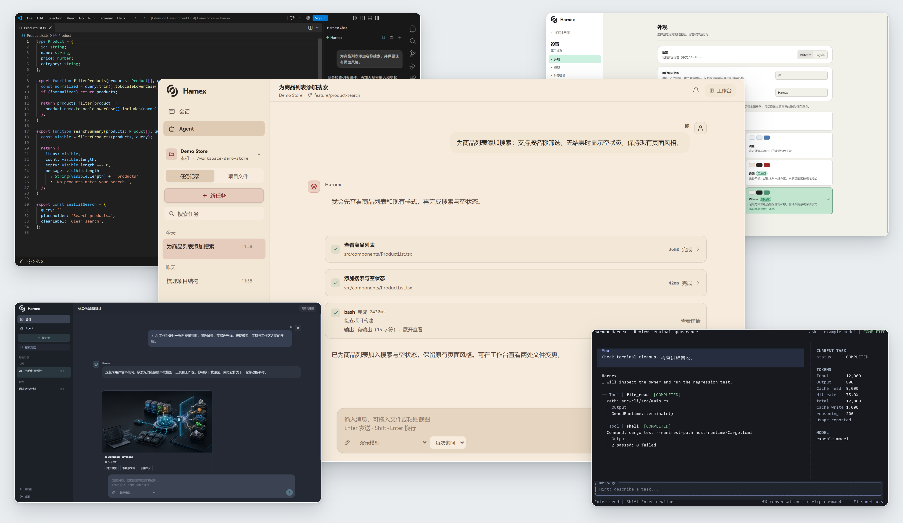

<p align="center">
  <picture>
    <source media="(prefers-color-scheme: dark)" srcset="docs/assets/brand/logo-dark.svg" />
    
  </picture>
</p>

<p align="center"><a href="README.md">English</a> · 简体中文</p>
<p align="center"><strong>对话、生图，以及真正进入项目工作的 Agent。</strong></p>
<p align="center">在浏览器、桌面、终端或 VS Code 中与 AI 一起完成工作。</p>

<p align="center">
  <a href="LICENSE"></a>
  <a href="#选择使用入口"></a>
  <a href="https://linux.do/"></a>
</p>

<p align="center">
  <a href="https://github.com/debug2048/Harnex/releases/latest">下载最新版</a> ·
  <a href="#界面预览">界面预览</a> ·
  <a href="#你可以做什么">核心用途</a> ·
  <a href="#快速开始">快速开始</a> ·
  <a href="#文档">文档</a> ·
  <a href="https://github.com/debug2048/Harnex/issues">反馈问题</a>
</p>

Harnex 将 AI 对话与项目工作放在同一个工作台中。你可以提问、生成图片，也可以让 Agent 进入项目，从理解代码、修改文件，一直推进到结果审阅。

连接你选择的模型，在本地或远程项目中工作，并随时查看进度、补充指令、审批操作或停止任务。

## 界面预览

[](docs/assets/screenshots/overview.png?raw=1)

## 你可以做什么

| 场景 | Harnex 能做什么 |
| --- | --- |
| **理解和修改项目** | 阅读代码、定位问题、编辑文件，并运行项目任务。 |
| **持续推进复杂任务** | 先制定计划，再跟踪进度，在执行过程中调整方向。 |
| **在对话中创作** | 提问、处理文档与图片，连接图片服务后生成或编辑图片。 |
| **掌握执行过程** | 查看文件变化、审批操作，并通过快照恢复支持的文件变更。 |
| **选择模型与工具** | 接入模型服务、Skills 和 MCP 工具，选择每项任务可使用的能力。 |
| **在本地或远程工作** | 操作本地项目或支持的 SSH 工作区，并在可用环境中安排定时任务。 |

模型能力取决于所选服务与配置，具体使用方式见[用户手册](docs/06_用户手册.md)。

## 快速开始

从 [GitHub Releases 下载当前版本](https://github.com/debug2048/Harnex/releases/latest)，按操作系统和 CPU 架构选择附件：

| 系统 | 文件名中的平台标识 | 桌面安装包 |
| --- | --- | --- |
| Windows x64 | `win32-x64` | `.exe` |
| macOS Apple Silicon（M 系列） | `darwin-arm64` | `.dmg` |
| macOS Intel | `darwin-x64` | `.dmg` |
| Linux x64 | `linux-x64` | `.AppImage` |
| Linux ARM64 | `linux-arm64` | `.AppImage` |

需要 CLI/TUI 或 VS Code 时，下载同平台的 `_offline.zip`（Windows）或 `_offline.tar.gz`（macOS/Linux）。离线包内含桌面安装程序（Linux 同时包含 DEB/RPM/AppImage）、便携 Runtime 和 UI/Runtime 两份 VSIX，内置 Java 与 ripgrep；无需 npm 或插件市场账号。项目自身的 Git、编译器等工具仍由项目环境提供。

1. 安装并打开 Harnex；首次体验可以先使用个人会话。
2. 在“设置 → 模型”中配置协议、服务地址、API Key（服务需要时）和准确的模型 ID，然后选择该模型。
3. 发送“请用一句话介绍你自己”确认连接。要体验项目 Agent，再打开自己的项目，先尝试“只阅读项目，说明目录结构，不修改文件”。

离线包不包含模型服务或调用额度。v1.0.0 的 Windows 安装器未正式签名，macOS 为 ad-hoc 签名且未公证；Linux 需要系统图形库。系统提示、文件校验及首次运行排障见[下载与首次运行](docs/04_部署方案.md#0-下载与首次运行)。各平台的实际验证范围以 [Release 说明](https://github.com/debug2048/Harnex/releases/tag/v1.0.0)为准。

### 从源码运行 Web

从源码体验 Web 工作台，可以使用 Docker。需要支持 Linux 容器的 Docker 和 **Docker Compose 2.24+**。

取得源码后，在项目根目录运行：

```bash
docker compose up -d --build
```

打开 **http://localhost:18081**，在“设置 → 模型”中配置模型，即可开始对话或 Agent 任务。首次构建需要联网下载依赖。

挂载已有项目、选择其他安装方式或配置远程访问，见[部署指南](docs/04_部署方案.md)。

## 选择使用入口

| 入口 | 适合什么场景 | 开始使用 |
| --- | --- | --- |
| **Web** | 在浏览器中进行对话和项目工作 | [Docker 部署](docs/04_部署方案.md#6-docker-compose-部署) |
| **桌面应用** | 日常使用原生应用窗口 | [桌面安装](docs/04_部署方案.md#35-原生桌面安装包windows--macos零依赖) |
| **CLI / TUI** | 终端交互与脚本任务 | [Release 便携包](https://github.com/debug2048/Harnex/releases/latest)与[终端说明](docs/04_部署方案.md#36-vs-codenative-cli-与完全离线包) |
| **VS Code** | 在编辑器内处理项目任务 | [VS Code 安装](docs/06_用户手册.md#213-vs-code-与原生-cli完全离线) |

发行目标包括 Windows x64、macOS Apple Silicon/Intel 和 Linux x64/ARM64。具体环境要求、可用产物和签名状态，以[平台说明](docs/04_部署方案.md#21-支持边界与平台验收)及对应发行说明为准。

## 文档

- [用户手册](docs/06_用户手册.md)：对话、生图、Agent、计划、Goal、工具与远程工作区。
- [部署指南](docs/04_部署方案.md)：安装、环境要求、升级、备份与排障。
- [源码构建](docs/04_部署方案.md#5-构建与发布维护者)：构建命令和发行产物。
- [English user guide](docs/en/user-guide.md) / [Installation guide](docs/en/installation.md)：英文使用和安装指南。

## 反馈

通过 [Issue 模板](https://github.com/debug2048/Harnex/issues/new/choose)报告问题或提出建议。请附上版本、操作系统、使用入口、复现步骤及脱敏日志。当前对外接受 Issue，PR 仅限协作者；说明见[反馈与贡献](CONTRIBUTING.md)。安全漏洞请按[安全报告指引](SECURITY.md)私密报告，不要在普通 Issue 中公开细节。

## 许可证

本项目的自有代码采用 [Apache License 2.0](LICENSE)。第三方组件遵循各自许可证，相关文本见 [docs/licenses](docs/licenses)及随组件分发的声明。
